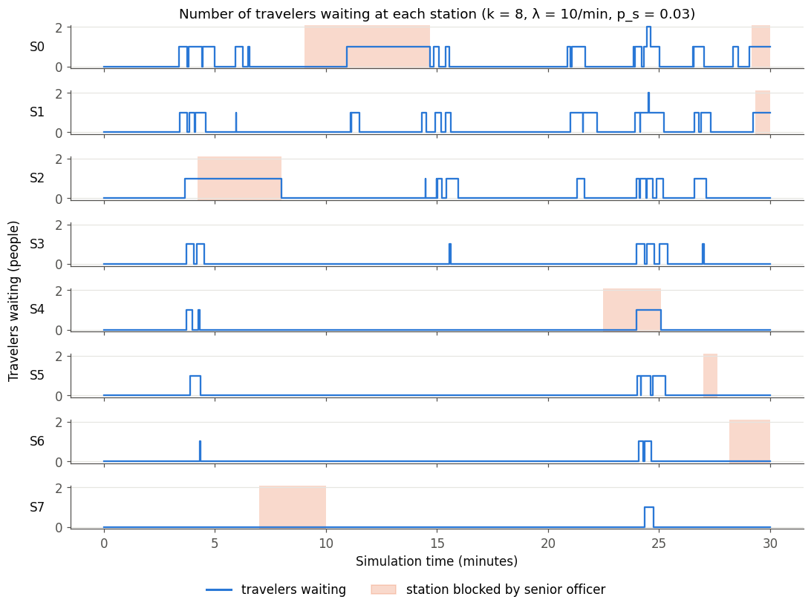
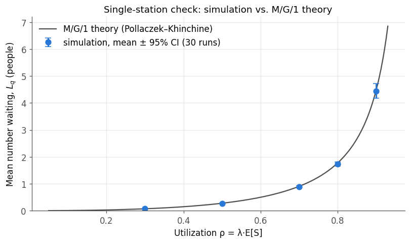
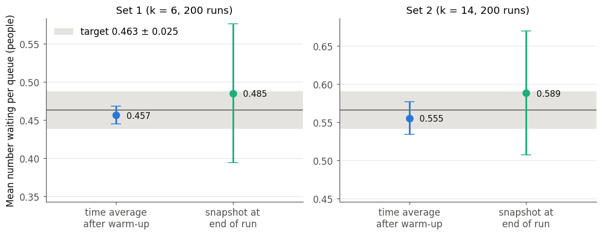
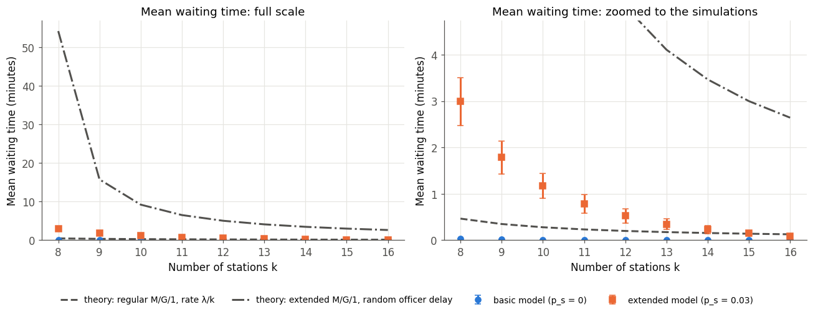
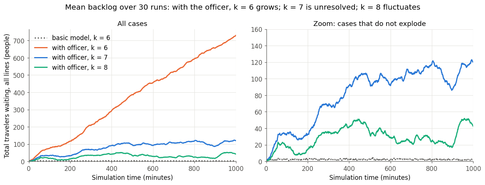
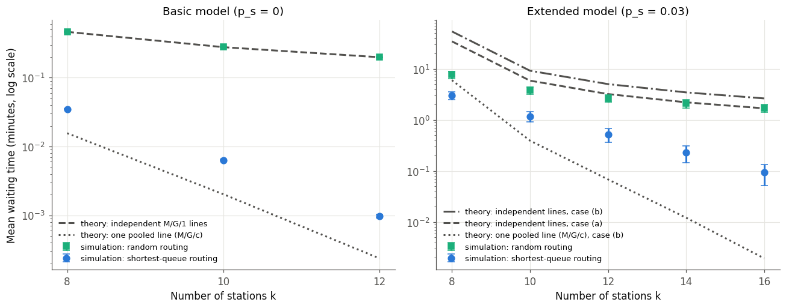

# How many security stations does an airport need?

A discrete-event simulation of an airport security checkpoint, combined with queueing theory, to decide how many screening stations to open. Built as the first project for **CS166 (Minerva University, Fall 2026)**.



## Key findings

- **One senior officer changes everything.** Only 3% of travelers need additional screening, but the single officer who handles them is busy 77% of the time. While a traveler waits for the officer, their whole station is blocked. This raises the minimum number of stations needed for stable queues from **6 to 8**.
- **Recommendation: 11 stations.** This is the smallest number whose mean waiting time stays under one minute with 95% confidence: 0.78 ± 0.20 min, compared with 2.99 ± 0.52 min at 8 stations.
- **The textbook formulas overestimate waits by up to 28×, and we found out why.** The formulas assume each traveler picks a line at random. When we made the simulation do the same, it matched the formula almost exactly (0.464 vs. 0.465 min). Choosing the *shortest* line is what keeps real waits short.

## The model

| Parameter | Value |
|---|---|
| Arrival rate λ | 10 travelers/min (Poisson process, so the gaps between arrivals are exponential) |
| Regular screening | Normal(30 s, 10 s), truncated at 0 (true mean 30.04 s) |
| Referral to senior officer | probability p_s = 0.03 |
| Officer inspection | Normal(2 min, 2 min), truncated at 0 (true mean 2.58 min) |
| Stations k | 6–16, one line per station |

Each traveler joins the line with the fewest people (counting the person being screened) and never switches. A referred traveler keeps their station blocked until the officer clears them. There is one officer, who serves stations first come, first served.

## How the simulation works

The simulation is **event-driven**. Instead of ticking a clock, it keeps a heap of future events (arrival, start and end of screening, start and end of an inspection) and always jumps to the earliest one.

| Class | Role |
|---|---|
| `Event`, `Schedule` | event calendar (min-heap) and simulation clock |
| `RandomStream` | one seeded random stream per source of randomness |
| `Queue` | one line and its station; records waits and queue lengths |
| `SeniorOfficer` | the single shared officer and their FIFO list of blocked stations |
| `Airport` | owns the queues and the officer; routes each arrival to the shortest line |
| `run_simulation`, `run_trials` | one replication, and many independent replications |

All model parameters are set in a single cell at the top of the notebook. Each source of randomness has its own seeded stream, so every result reproduces exactly. Turning the officer off (p_s = 0) leaves all other random draws unchanged.

## How we know it's right

- **State trace and visualization:** the figure at the top shows the lines staying balanced and growing only while a station is blocked.
- **Hand-computed cases:** with deterministic inputs, every waiting time matches a paper calculation exactly.
- **Queueing theory:** with one station, the simulation matches the Pollaczek–Khinchine formula from utilization 0.3 to 0.9.
- **Provided test cases:** 0.457 ± 0.012 against a target of 0.463 ± 0.025, and 0.555 ± 0.021 against 0.566 ± 0.025.
- **Reduction checks:** setting p_s = 0, or the officer's time to zero, reproduces all 2,085 individual waiting times of the basic model exactly.
- **Stationarity:** we averaged 200 runs from an empty airport to choose the warm-up period (300 min with the officer).

<p float="left">
  
  
</p>

## Results

50 independent simulated days per station count; each day is 1,440 minutes after a 300-minute warm-up. All values are 95% confidence intervals of the mean.

| Stations k | Mean wait (min) | Mean queue per line | Worst line of the day |
|---|---|---|---|
| 8  | 2.99 ± 0.52 | 3.74 ± 0.65 | 24.8 ± 2.9 |
| 9  | 1.78 ± 0.35 | 1.98 ± 0.39 | 18.0 ± 2.3 |
| 10 | 1.17 ± 0.27 | 1.18 ± 0.27 | 13.6 ± 2.0 |
| **11** | **0.78 ± 0.20** | **0.71 ± 0.18** | **10.2 ± 1.7** |
| 12 | 0.52 ± 0.16 | 0.44 ± 0.13 | 7.6 ± 1.5 |
| 14 | 0.23 ± 0.08 | 0.16 ± 0.06 | 4.1 ± 1.0 |
| 16 | 0.09 ± 0.04 | 0.06 ± 0.03 | 2.2 ± 0.6 |

Without the officer, the mean wait never exceeds 0.035 minutes, so the officer causes almost all of the waiting.



With the officer, 6 stations are unstable (the backlog grows without limit), 7 drift slowly upward, and 8 settle:



## Why theory and simulation disagree

The independent-queue M/G/1 analysis gets the structure right: it identifies the officer bottleneck and puts the capacity threshold at about 7.6 stations. But it predicts waits up to 28× longer than the simulation. To find out why, we reran the simulation with **one change: travelers pick a random line**, which is exactly what the theory assumes.



- **Basic model:** random routing reproduces the formula almost exactly. Shortest-line routing falls between that and a pooled single-line (M/G/c) benchmark.
- **With the officer:** routing explains most of the gap, 3× at k = 10 and 18× at k = 16. The remainder comes from the officer model. In the simulation, a referred traveler waits about 3.8 minutes for the officer, not the 6.0 the M/G/1 formula predicts, because a blocked station cannot send another referral.

## Repository structure

```
├── airport_security_simulation.ipynb   # full simulation, tests, experiments and figures (with outputs)
├── report/report.pdf                   # written report: model, theory, results and appendices
├── figures/                            # figures exported from the notebook
├── requirements.txt
└── README.md
```

## Run it yourself

```bash
git clone https://github.com/<your-username>/cs166-airport-security-queues.git
cd cs166-airport-security-queues
pip install -r requirements.txt
jupyter notebook airport_security_simulation.ipynb
```

Then run **Kernel → Restart & Run All**. A full run takes about 10 minutes. All results are seeded and reproduce exactly.

## Limitations

The arrival rate is constant all day, so 11 stations is really a peak-hour answer. Travelers see every line perfectly and never switch lines, and staffing never changes during the day. Near capacity, stationarity is shown empirically rather than proven. The natural next step is to test a second senior officer, since the officer is the real bottleneck.

## Authors and acknowledgments

**Almira [Surname]** and **[Teammate name]**, CS166, Minerva University.

The event-scheduling engine builds on code from the CS166 course materials. Claude (Anthropic) was used to help with understanding course concepts, reusing class code, debugging the notebook and formatting the report, as described in the report's acknowledgments.
